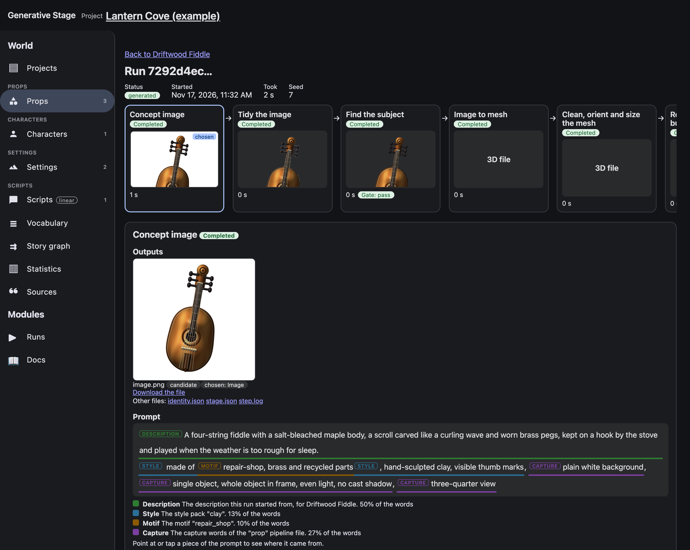
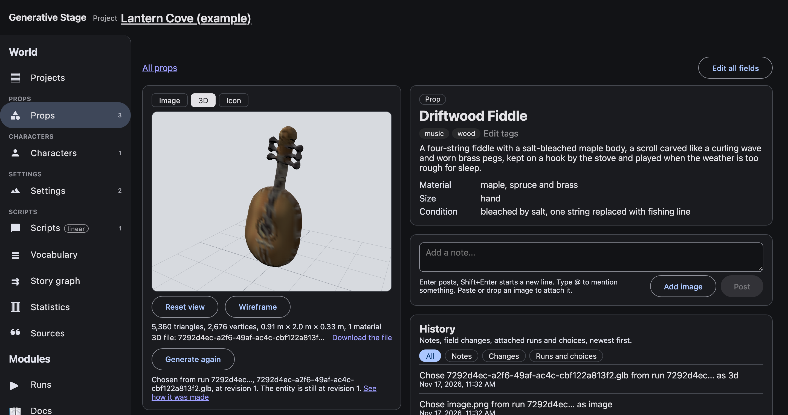
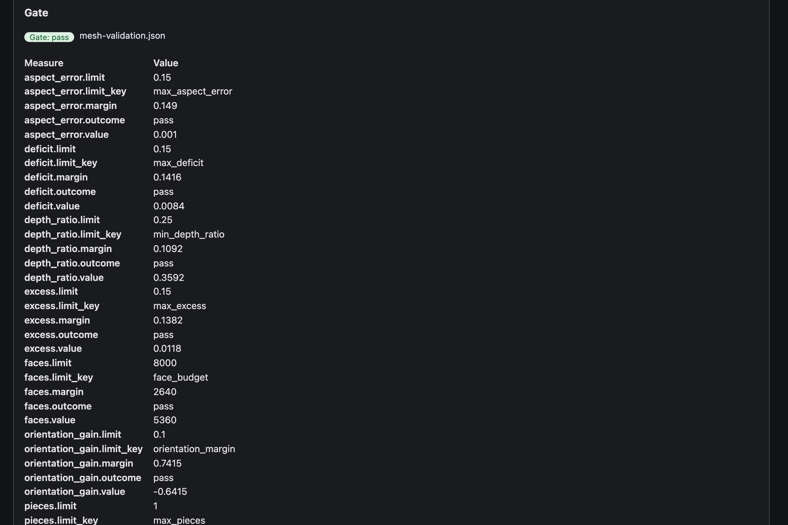
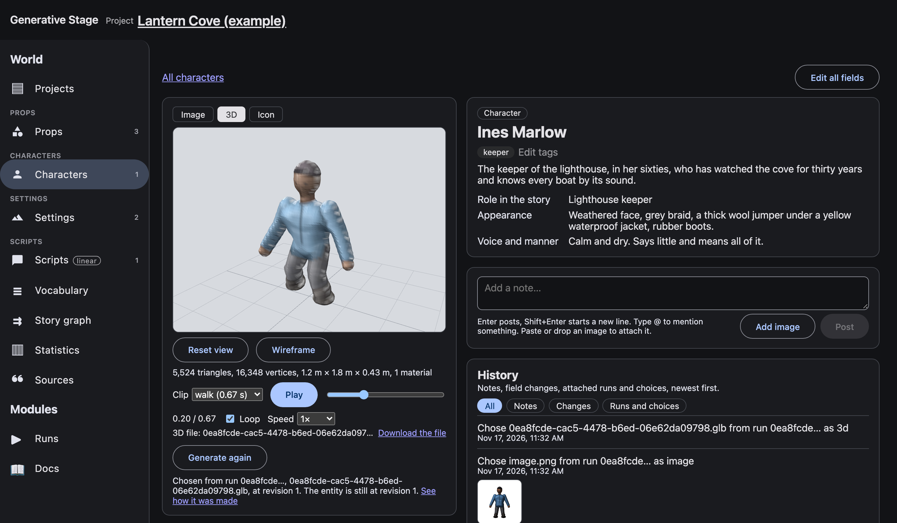
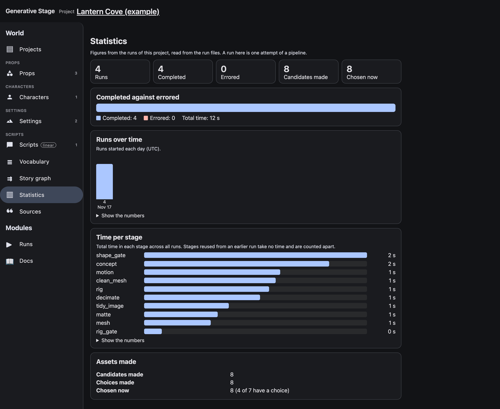

# Generative Stage

A local tool for building the cast, places and props of a story world, and for turning each written brief into
concept images, 3D models and motion clips with a record of exactly how every result was made.



The pictures here were made with the tool's built-in procedural generators, which draw each subject from the words of its brief and raise a 3D model from the drawing's outline, with no AI model; a model plugged in through the [adapter contract](docs/adapters.md) takes their place.

You describe a world as linked records: a character *lives in* a setting, a prop *belongs to* a character. A pipeline
turns a record's brief into assets, stage by stage. Every stage writes down what it read and what it made, so any
asset can be opened to see the exact prompt, where each word of it came from, the inputs and outputs with their
hashes, and the measurements of every quality check. What you choose is exported as glTF models and a JSON manifest
that any engine can read.

Everything runs on your own computer and nothing is sent anywhere. **No model ships with it and no GPU is needed**:
every stage runs on a built-in stand-in that draws its output procedurally, so the install, the example, the tests
and the container all work as they are. A model of your own plugs in through a small, documented
[adapter contract](docs/adapters.md).

It is a work in progress. Names, layout and interfaces may change.

## What it does

| | |
|---|---|
|  | **A world of linked records.** Each record has a brief, fields from its kind's schema, notes, history and links; its chosen picture and model sit beside it, with a viewer. (Here, the Driftwood Fiddle's model, raised from its picture.) |
|  | **A trace for every run, and checks that inform, not block.** Each stage shows its prompt, colour-coded by source, its settings, and its files with their hashes. Gates measure a result (is the subject whole, is the mesh closed, is it the right size) against limits; the choice stays with you. |
|  | **Rigging and motion.** Headless Blender scripts rig a character and build clips procedurally; the viewer plays them. |
|  | **Statistics from plain files.** Runs over time, time per stage, completed against errored, made against chosen. |

Also: a record form generated from each kind's JSON Schema, revisions and notes on every record, a condition
vocabulary and story graph for scripts, an [MCP server](docs/mcp.md) so an agent can do everything the web app can,
and a [Docker image](docs/platform.md).

## How it is built

```
 browser ──► web gateway ──► API ─────────────► world model (SQLite) and the job queue
 agent ──► MCP server ──►     │
                              ├─► pipeline runner ──► stages ──► adapters (stand-in, or your model)
                              └─► read-only run server ──► run folders (plain files)
```

| Part | What | Built with |
|---|---|---|
| `core/` | The world model: kinds from JSON Schema, records with revisions, links, vocabulary, story graph | Python, SQLite |
| `pipeline/` | The runner, its deterministic stages (image tidying, subject mask, mesh clean-up, shape gates) and pipeline files | Python, NumPy, SciPy, trimesh, Pillow |
| `server/` | The HTTP API, the read-only run server, the web gateway, the MCP server and a command-line tool | Python (standard library servers), uv |
| `ui/` | The web app, with a 3D viewer and clip player | Angular, TypeScript, three.js |
| `export/` | The bundle writer, its manifest schema, and an example reader for Godot | Python, JSON Schema |
| `blender/` | Rigging, procedural motion and procedural example models, run headless | Blender's Python API |

Some choices that shaped it:

- **A run is plain files.** The trace, the statistics and the read-only server read run folders, so a result can be
  audited without the tool that made it.
- **Only the computer's owner can define a command.** Adapters live in one machine config file. No project file, API
  call or agent can add one; they can only choose among those already there ([trust rule](docs/adapters.md#trust-rule)).
- **Loopback only.** Each server binds `127.0.0.1` and refuses requests whose `Host` or `Origin` is not its own.
- **The agent interface has no logic.** Every MCP tool is one API request, so an agent can do nothing the API refuses.
- **It names no game.** Anything particular to one story or engine is data: kind schemas, pipeline files, style packs.

More in [Architecture](docs/architecture.md).

## Try it

You need macOS or Linux, `python3` 3.10 or newer, [uv](https://docs.astral.sh/uv/) and Node.js 22.22.3 or newer.
Blender is optional (rigging and motion only).

    ./install.sh
    ./start.sh
    python3 scripts/load_example.py http://127.0.0.1:4280     # in a second terminal

Then open <http://127.0.0.1:4280> and pick **Lantern Cove (example)**. Or, with Docker and nothing else installed:
`docker compose up`.

The [walkthrough](docs/walkthrough.md) goes from there to an exported asset in nine steps: write briefs and link
them, generate, read the trace, export, plug in a model, and drive it from an agent.

## Running the checks

After `./install.sh --dev`, one command runs the checks of each part (`e2e` adds the browser specs and needs
`npx playwright install chromium` once):

    scripts/check.sh pipeline server ui

These are also available one by one: the pipeline tests (`python3 -m unittest discover -s pipeline/tests`), the server,
`core/` and `export/` tests with linter and type checker (from `server/`: `uv run pytest -q`, `uv run ruff check . ../core ../export`,
`uv run mypy`) and the web app (from `ui/`: `npx ng test --watch=false`, `npx ng build`, `npm run test:node`). The full
pipeline check, which also builds the Blender examples headlessly, is `pipeline/check.sh`. The Linux run in a container
is in [platforms](docs/platform.md#checks-on-linux). No check needs a model or a GPU: every model stage runs on the stand-ins. The tests
that run the image and mesh tools, and the browser specs' throwaway server, use the tools interpreter named by
`GENSTAGE_TEST_TOOLS_PYTHON`, else the `tools_python` of your machine config (`./install.sh` sets it to `.venv-tools`).

## Documentation

- [Walkthrough](docs/walkthrough.md): nine steps from install to an exported asset.
- [Architecture](docs/architecture.md): the parts and how a run flows through them.
- [Platforms, ports and the image](docs/platform.md), [machine settings](docs/machine_settings.md) and [configuration](server/docs/configuration.md).
- [Integrating a model](docs/adapters.md): the adapter contract for each kind, a worked example, and the trust rule.
- [World model API](docs/api.md), [MCP server](docs/mcp.md), [export bundle](docs/export_bundle.md).
- [Pipeline files](docs/pipeline_files.md), [normalisers](docs/normalisers.md), [shape gate](docs/gate_v2.md), [motion](docs/motion.md), [GPU lock](docs/gpu_lock.md).
- [Condition vocabulary](docs/vocabulary.md) and [story graph](docs/story_graph.md).
- [Third-party software](THIRD_PARTY.md) and the [Blender scripts' licence note](blender/LICENSE-NOTE.md).

## How this was built

I designed this tool, directed the work and reviewed what went in. Much of the code was written by AI coding agents
(Claude) working to my designs, in small reviewed changes, with the checks above as the bar each change had to pass.
Commits that an agent wrote carry a `Co-Authored-By` line.

## Author and licence

Made by Dan Crean ([@danielcrean4](https://github.com/danielcrean4)).

MIT, see [LICENSE](LICENSE). The scripts in `blender/` use Blender's Python API and are offered under MIT or
GPL-3.0-or-later, your choice ([note](blender/LICENSE-NOTE.md)). Dependencies and the programs the tool can call have their
own licences: [THIRD_PARTY.md](THIRD_PARTY.md).
